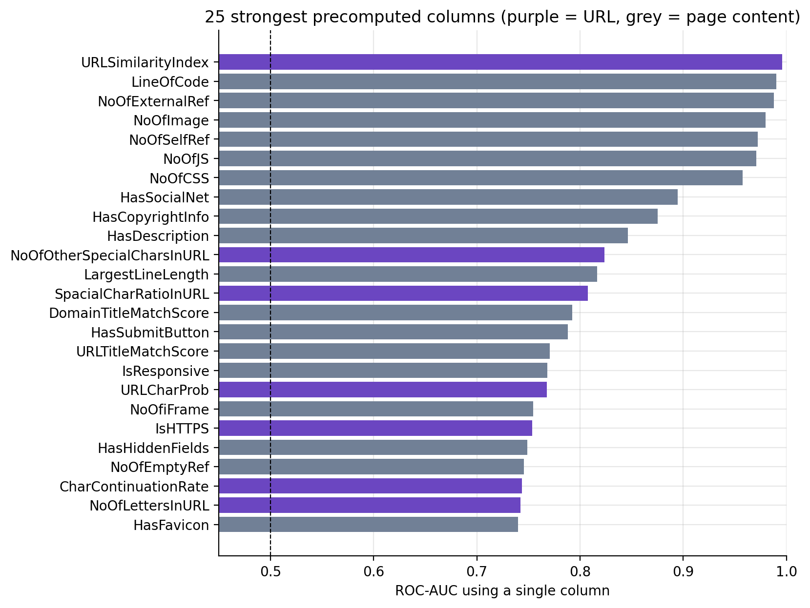
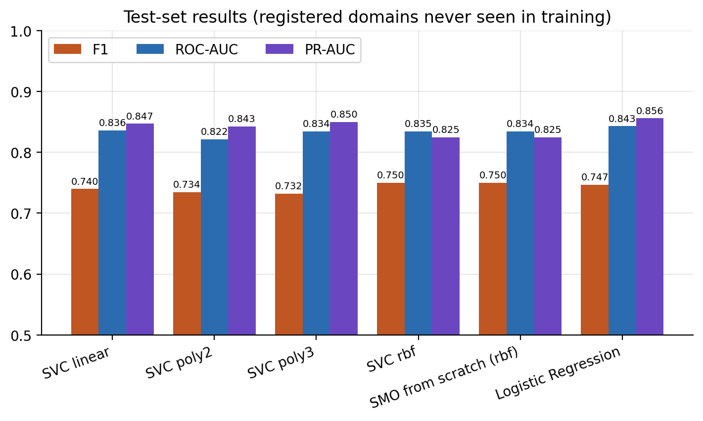

# Phishing Hostname Detection with Support Vector Machines

Classify a **hostname** (e.g. `abcbank-xacminh.secure-login.xyz`) as **phishing** or **legitimate** from the
string alone, without opening the page. The model is a **soft-margin SVM with an RBF kernel**, trained with a
**from-scratch implementation of the SMO algorithm** (`src/smo.py`) and verified to match LIBSVM
(`sklearn.svm.SVC`).

Midterm project for the course **Introduction to Machine Learning**, topic *Support Vector Machine*.

**Highlights**

- **The data is audited before it is used.** PhiUSIIL (235,795 URLs) contains a format bias that lets a single
  if–else rule reach 99.56% accuracy, and a label-leaking column (AUC 0.996). The task was redesigned to avoid both.
- **SMO written from scratch**: dual problem, second-order working-set selection (Fan–Chen–Lin), analytic
  two-variable update (Platt). It matches LIBSVM on the dual objective, support vectors and predictions.
- **Step-by-step theory walkthrough** ([notebook 00](notebooks/00_svm_walkthrough.ipynb)): margin, Lagrangian and
  dual, KKT, one SMO step computed by hand, soft margin, the kernel trick (XOR solved by hand) and the effect of
  γ and C, with every hand calculation asserted against the solver.
- **Rigorous evaluation**: train/test split and cross-validation **grouped by registered domain**, so the model is
  scored on hosting platforms it has never seen. Scaling lives inside the pipeline; the test set is used once.
- **Best model**: RBF SVM (C = 1, γ = 0.3), **F1 = 0.750**, precision 0.925, ROC-AUC 0.835 on 45,087 test hostnames.
- **Offline web demo** that explains each prediction with the SVM decision function $f(x) = \sum_i \alpha_i y_i K(x_i, x) + b$.

## Contents

1. [Problem](#1-problem)
2. [Why this problem suits an SVM](#2-why-this-problem-suits-an-svm)
3. [Dataset](#3-dataset)
4. [Method](#4-method)
5. [Results](#5-results)
6. [Best model](#6-best-model)
7. [Web demo](#7-web-demo)
8. [Setup and reproduction](#8-setup-and-reproduction)
9. [Repository layout](#9-repository-layout)
10. [Limitations and future work](#10-limitations-and-future-work)
11. [References](#11-references)

---

## 1. Problem

| | |
|---|---|
| **Input** | A hostname, e.g. `metamask-wallet-restore.firebaseapp.com` |
| **Output** | Label $y \in \{-1, +1\}$ (legitimate / phishing) and the decision value $f(x)$ |
| **Representation** | 17 numeric features extracted from the hostname string, $x \in \mathbb{R}^{17}$ |
| **Positive class** | Phishing (the class to detect) |
| **Main metric** | F1 of the phishing class, with precision, recall, ROC-AUC and PR-AUC |

The model reads only the string, so it can run **before the user clicks the link**: no page download, no
network lookup.

## 2. Why this problem suits an SVM

**Application.** Link-based phishing (fake banks, crypto wallets, email services) is a common attack. Blocklists
only stop domains that have already been reported; a learned model can flag **newly registered** domains from
their shape.

**Algorithm.** The problem plays to the SVM's strengths and exercises its core concepts:

| Property of the problem | Link to the SVM |
|---|---|
| **Binary** classification | The SVM's native setting; the from-scratch SMO needs no OvR/OvO wrapper |
| Numeric, low-dimensional (17), long-tailed features on different scales | Shows why scaling matters for kernel distances |
| **Overlapping** classes, not linearly separable | A **soft margin** is required; C has an observable effect |
| Non-linear interactions (long + many digits + subdomain) | A meaningful comparison of linear, polynomial and RBF kernels |
| 219 thousand samples | The $O(n^2)$ cost of kernel SVMs can be measured and compared with LinearSVC |
| Genuine borderline cases (legitimate domains that look "odd") | Support vectors are interpretable: they are the hardest hostnames to tell apart |

## 3. Dataset

### Source and why it was chosen

**PhiUSIIL Phishing URL Dataset** (UCI Machine Learning Repository, 2024, CC BY 4.0):
235,795 URLs, 56 columns, original labels `1` = legitimate, `0` = phishing.

- **Recent and large**: published in 2024 (Prasad & Chandra, *Computers & Security*), covering current phishing
  hosts such as IPFS, Firebase and Replit.
- **Raw URL column available**: features are extracted by the project instead of reusing the authors' precomputed ones.
- **Open licence** with a clear academic citation.

### Audit: three findings ([notebook 01](notebooks/01_data_audit.ipynb))

**1. URL format bias.** 100% of legitimate URLs are bare homepages of the form `https://www.<domain>` with no path.
A single if–else rule reaches **99.56% accuracy**. Any feature taken from the scheme, `www.` or the path would only
relearn how the data was collected.

| | Legitimate | Phishing |
|---|---|---|
| Uses `https` | 100% | 48.7% |
| Starts with `www.` | 100% | 41.4% |
| Has a path / query | 0% | 28.4% |

**2. Label leakage.** `URLSimilarityIndex` alone reaches **AUC 0.996**, because it measures similarity to the very
list of legitimate URLs used to create the labels. The 28 page-content (HTML) columns require downloading the page
and are out of scope.



**3. Shared hosting platforms.** Thousands of phishing hostnames share one registered domain (`web.app`,
`firebaseapp.com`, `repl.co`). A random train/test split would put the same platform on both sides and inflate the
results.

### Decisions and final dataset

Keep only the **hostname**, the one piece of information both classes genuinely have. Drop all 54 precomputed
columns, remove duplicated URLs, collapse URLs that share a hostname, and drop hostnames carrying both labels.

| | |
|---|---|
| File | [`data/processed/hosts.csv`](data/processed/hosts.csv) (11 MB, in the repo) |
| Size | **219,036 hostnames**: 84,244 phishing (38.5%), 134,792 legitimate |
| Groups | 175,452 registered domains |
| Log | [`cleaning_log.json`](data/processed/cleaning_log.json): every removal step and SHA-256 hashes |

| Column | Meaning |
|---|---|
| `host` | Hostname without `www.`; the model's only input |
| `registered_domain` | Registered domain (eTLD+1), used as the group when splitting |
| `subdomain`, `suffix` | Split with the Public Suffix List |
| `is_ip` | 1 if the hostname is an IP address |
| `n_urls` | Number of raw URLs collapsed into this hostname (analysis only) |
| `phishing` | **1 = phishing**, 0 = legitimate |

## 4. Method

### Features ([`src/features.py`](src/features.py))

| Group | Features |
|---|---|
| Length, structure | `host_len`, `n_labels`, `max_label_len`, `domain_label_len` |
| Characters | `n_hyphens`, `n_digits`, `digit_ratio`, `vowel_ratio`, `max_consonant_run` |
| Randomness | `entropy` (Shannon, bits per character) |
| Special forms | `is_ip`, `has_punycode` |
| Keywords | `n_sensitive_words` (login, verify, secure…), `brand_not_owner` (e.g. `paypal-secure.com`) |
| Subdomain | `has_subdomain`, `subdomain_labels`, `subdomain_len` |

Keyword lists were fixed in advance, not tuned on the data. No single feature exceeds AUC 0.77, so the task is
not trivial.

### Data split and model selection

```text
hosts.csv (219,036)
├── TRAIN 79.4% (173,949)  ── stratified subsample of 8,000 for kernel SVMs
│                              └── 5-fold StratifiedGroupKFold (group = registered domain)
│                                  Pipeline(StandardScaler → SVC), C and γ selected by F1
└── TEST 20.6% (45,087)    ── unseen registered domains, used once for the final score
```

When two configurations differ by less than one cross-validation standard error, the simpler one is kept
(*one-standard-error rule*).

### SVM and the from-scratch SMO ([`src/smo.py`](src/smo.py))

Dual problem of the soft-margin SVM:

$$\min_{\alpha}\ \frac{1}{2}\sum_{i,j}\alpha_i\alpha_j y_i y_j K(x_i,x_j) - \sum_i \alpha_i
\quad\text{s.t.}\quad 0 \le \alpha_i \le C,\ \ \sum_i \alpha_i y_i = 0$$

Each iteration:
1. Pick the pair $(i, j)$ that violates the KKT conditions the most, with the second-order rule of Fan, Chen & Lin (2005).
2. Solve the two-variable sub-problem analytically (Platt, 1998): $\eta = K_{ii} + K_{jj} - 2K_{ij}$,
   $\alpha_j \leftarrow \text{clip}\big(\alpha_j + y_j (E_i - E_j)/\eta,\ L,\ H\big)$, then update $\alpha_i$ and the error cache $E$.
3. Stop when the KKT violation $m - M < 10^{-3}$.

Linear, polynomial and RBF kernels are supported. `record_trace=True` prints every step for comparison with a
hand-worked example.

The theory behind these steps (hard and soft margin, the Lagrangian and dual, KKT conditions, the kernel trick)
is derived in [notebook 00](notebooks/00_svm_walkthrough.ipynb) on 2-D examples that can be plotted: one SMO
step on the 3-point example computed by hand and compared number by number with the solver's trace, a
soft-margin example where KKT sorts every point into $\alpha = 0$, $0 < \alpha < C$ or $\alpha = C$, XOR solved by
hand with the kernel $(x^\top z)^2$ (giving $f(x) = x_1 x_2$), and the effect of C and γ on decision boundaries.

**Verification** ([`tests/test_smo.py`](tests/test_smo.py), [`experiments/check_smo_vs_sklearn.py`](experiments/check_smo_vs_sklearn.py)):

| Check | Result |
|---|---|
| 3-point example $(1,1)^-, (2,2)^+, (3,3)^+$ | Converges in **exactly one step**: $\alpha = (1, 1, 0)$, $w = (1, 1)$, $b = -3$ |
| KKT conditions of the solution | $\alpha = 0$ outside the margin, $0 < \alpha < C$ on the margin, $\alpha = C$ violating it, $\sum \alpha y = 0$ |
| Against `SVC` on synthetic data (3 kernels) | Identical support vectors, $\lvert\Delta f\rvert < 10^{-3}$, 100% identical predictions |
| Against `SVC` on the real data | Equal dual objective (−720.9346), 99.98–100% identical predictions |

## 5. Results

All experiments and plots are in [notebook 02](notebooks/02_experiments.ipynb) (FULL mode). Quality metrics are
deterministic: re-running gives identical values. Times are wall-clock on the team's machine (20 CPU threads) and
vary by about 10–20% between runs. Every CSV and figure of the FULL run quoted here is in
[`outputs/experiments/20261027-224952-full/`](outputs/experiments/20261027-224952-full/); each new run is saved
to its own local `outputs/experiments/<timestamp>/` folder.



### Model comparison (test: 45,087 hostnames from unseen registered domains)

| Model | Parameters | Precision | Recall | **F1** | ROC-AUC | Support vectors | Fit time |
|---|---|---|---|---|---|---|---|
| **SVC RBF** | C = 1, γ = 0.3 | 0.925 | 0.630 | **0.750** | 0.835 | 3,612 | 3.0 s |
| **From-scratch SMO (RBF)** | C = 1, γ = 0.3 | 0.925 | 0.630 | **0.750** | 0.834 | 3,567 | 24.4 s |
| SVC linear | C = 10 | 0.909 | 0.624 | 0.740 | 0.836 | 3,142 | 9.9 s |
| SVC polynomial, degree 2 | C = 10 | 0.949 | 0.599 | 0.734 | 0.822 | 3,375 | 8.6 s |
| SVC polynomial, degree 3 | C = 1 | 0.946 | 0.597 | 0.732 | 0.834 | 2,893 | 10.6 s |
| Logistic Regression | — | 0.919 | 0.629 | 0.747 | 0.843 | — | 0.1 s |
| LinearSVC (all 173,949) | C = 1 | 0.921 | 0.626 | 0.745 | 0.842 | — | 1.0 s |
| Majority class | — | 0 | 0 | 0 | 0.500 | — | — |

### C × γ search (RBF kernel, mean F1 over 5-fold CV)

| C \ γ | 0.003 | 0.03 | 0.3 | 3 |
|---|---|---|---|---|
| 0.1 | 0.665 | 0.683 | 0.693 | 0.147 |
| 1 | 0.677 | 0.688 | **0.701** | 0.689 |
| 100 | 0.688 | 0.694 | 0.684 | 0.657 |

The optimum is a flat plateau (the ±0.10 fold-to-fold standard deviation is larger than the gaps between cells).
Small C with large γ **underfits**; large C with large γ degrades through **overfitting**. The best cell lies inside
the 7×7 grid, not on its edge.

### Training time versus sample size

| n | SVC RBF (LIBSVM) | From-scratch SMO | LinearSVC | SVC RBF F1 | Support vectors |
|---|---|---|---|---|---|
| 1,000 | 0.04 s | 0.22 s | 0.003 s | 0.745 | 578 |
| 8,000 | 2.0 s | 18.3 s | 0.04 s | 0.750 | 3,612 |
| 32,000 | 41.8 s | — | 0.11 s | 0.749 | 13,169 |
| 173,949 | — | — | 1.0 s | 0.745 (LinearSVC) | — |

Kernel SVM time grows roughly as **O(n²)** and the number of support vectors grows almost linearly with n. F1
saturates from about 4,000 samples, so more data does not help the model.

### Observations

- **The from-scratch SMO matches LIBSVM's quality** (F1 0.750 for both) and is about 8× slower, being pure Python.
- **All kernels and Logistic Regression are nearly tied.** With 17 dimensions and n ≫ p the decision boundary is
  close to linear; the ceiling is set by the features, not by the model.
- **High precision, lower recall**: few false alarms (FPR ≈ 3.4%), but 37% of phishing hostnames are missed.
- **Subdomain dependence**: with features of the registered domain only, RBF F1 drops to 0.327 (ROC-AUC 0.511).
- **log1p / binarising count features does not help** (CV F1 0.704 vs 0.701, below the 0.045 standard error), so
  plain `StandardScaler` is kept.

## 6. Best model

| | |
|---|---|
| Model | Soft-margin SVM, RBF kernel $K(x,z) = \exp(-0.3\,\lVert x - z\rVert^2)$, C = 1 |
| Solver | **From-scratch SMO** (`src/smo.py`), 32,305 iterations, about 16 seconds |
| Training data | 8,000 hostnames (stratified subsample of the training set), z-score standardised |
| Support vectors | 3,567 |
| Test results | F1 **0.750** · precision 0.925 · recall 0.630 · ROC-AUC 0.834 |
| Files | [`models/svm_rbf.npz`](models/svm_rbf.npz) (mean, scale, support vectors, $\alpha_i y_i$) + [`models/svm_rbf.json`](models/svm_rbf.json) (b, γ, C, feature names, metrics) |

The model is stored as `npz` + `json`, **without pickle**, so it loads safely and is human-readable. Rebuild it
with `python -m scripts.train_demo_model`.

## 7. Web demo

```powershell
.\.venv\Scripts\python.exe demo/server.py        # open http://127.0.0.1:8000
```

- Enter a URL or a hostname; the demo extracts the hostname, strips userinfo and port, and converts Unicode
  domains to punycode.
- **Margin-based verdict**: $f \ge 1$ phishing, $f \le -1$ legitimate, $-1 < f < 1$ uncertain.
- **Explanation**: $f(x)$ is split into the pull of phishing-side support vectors, legitimate-side support vectors
  and the bias $b$; the 5 most influential support vectors and the 17-feature vector are shown.
- **Out-of-distribution warning** when the hostname is far from every support vector ($K \approx 0$, so $f \approx b$).
- Python standard library only, works offline, accepts connections from `127.0.0.1` only.

## 8. Setup and reproduction

Requires **Python 3.12** (3.13 is not supported by `numpy==1.26.4`). Run every command from the repository root.

```powershell
git clone https://github.com/weamon17/svm_phising.git
cd svm_phising
python -m venv .venv
.\.venv\Scripts\python.exe -m pip install -r requirements.txt
.\.venv\Scripts\python.exe -m pytest -q            # 44 passed
```

**Windows one-click alternative**: double-click `setup.bat` (once), then `run_tests.bat` and `run_demo.bat`.
Keep the project folder path short (at most ~100 characters, e.g. `C:\SVM\svm_phising`): files inside `.venv` add
about 150 characters and Windows limits paths to 260. `setup.bat` checks this.

The cleaned dataset and the model are in the repo, so notebook 02, the demo and the tests run immediately.
To rebuild from the raw data (needs network, about 30 seconds):

```powershell
.\.venv\Scripts\python.exe scripts/download_data.py    # download the raw UCI CSV, verify SHA-256
.\.venv\Scripts\python.exe -m scripts.make_clean_data  # rebuild hosts.csv; SHA-256 matches cleaning_log.json
```

| Task | Command | Time |
|---|---|---|
| SVM walkthrough (no data needed) | open `notebooks/00_svm_walkthrough.ipynb` → Run All | ~5 s |
| Data notebook (needs the raw data) | open `notebooks/01_data_audit.ipynb` → Run All | ~20 s |
| Experiments notebook | open `notebooks/02_experiments.ipynb` → Run All. It is saved with FULL results (`QUICK = False`, ~45 min); set `QUICK = True` for a ~4 min smoke test | ~4 / ~45 min |
| SMO versus LIBSVM | `python -m experiments.check_smo_vs_sklearn` | ~30 s |
| Preprocessing comparison | `python -m experiments.compare_preprocessing` | ~8 min |
| Retrain the model | `python -m scripts.train_demo_model` | ~25 s |
| Run a notebook without Jupyter | `python scripts/execute_notebook.py notebooks/02_experiments.ipynb` | |

**macOS/Linux**: replace `.\.venv\Scripts\python.exe` with `.venv/bin/python`.
**VS Code**: select the `.venv (Python 3.12)` kernel before Run All, and press Ctrl+S afterwards to keep the outputs.
All three notebooks are generated by `scripts/build_*_notebook.py`; running those scripts **overwrites** the
notebooks and clears their outputs.

### Team workflow (experimenting and improving)

1. Work on a branch per idea: `git switch -c exp/<short-name>` (e.g. `exp/token-keywords`).
2. Change code in `src/`, then check it with `QUICK = True` in notebook 02 (~4 min) before any FULL run.
3. Compare against the reference results in section 5. Keep a change only if the CV F1 gain is larger than one
   standard error (≈0.045 here); otherwise it is noise.
4. Run `run_tests.bat` (or `python -m pytest -q`); add a test for any new feature or solver change.
5. New runs in `outputs/experiments/` stay local (ignored by Git). To publish a new reference run, update the run
   folder in `.gitignore` and in this README.
6. Commit, push the branch and open a pull request; merge into `main` after a teammate reviews it.

Promising directions are listed in section 10.

### Building the submission package

```powershell
.\.venv\Scripts\python.exe -m pip install -r requirements-dev.txt     # once: adds nbconvert for HTML export
.\.venv\Scripts\python.exe -m scripts.make_submission --ids <ID1> <ID2> <ID3> `
    --report BaoCao.docx BaoCao.pdf --slides Slide.pptx
```

It creates `dist/<ID1>_<ID2>_<ID3>/` and `dist/<ID1>_<ID2>_<ID3>.zip` with the report, slides, both notebooks
exported to HTML, the source code (exactly the files Git would commit) and a grading guide `HUONG_DAN.md`.
It refuses to build while the report or slides are missing; add `--draft` for a test build.

## 9. Repository layout

```text
├── src/                      Shared source code
│   ├── data.py               Hostname and registered-domain parsing, cleaning
│   ├── features.py           17 hostname features
│   ├── smo.py                SVM + from-scratch SMO (linear / polynomial / RBF)
│   ├── splits.py             Split by registered domain, stratified subsampling
│   ├── preprocessing.py      log1p / binarise, one-standard-error rule
│   └── demo.py               Prediction and explanation for the demo
├── notebooks/
│   ├── 00_svm_walkthrough.ipynb  How the SVM works: theory + worked examples
│   ├── 01_data_audit.ipynb   Data audit and cleaning
│   └── 02_experiments.ipynb  Experiments (FULL run saved)
├── data/
│   ├── raw/                  Source metadata + SHA-256 (raw CSV downloaded by script)
│   └── processed/            hosts.csv + cleaning_log.json
├── models/                   Best model (npz + json)
├── outputs/
│   ├── eda/                  6 data figures (notebook 01)
│   ├── experiments/…-full/   FULL run: 7 figures + CSVs (results, grids, timing, errors)
│   └── smo_check/            From-scratch SMO versus LIBSVM on the real data
├── experiments/              Command-line experiments
├── scripts/                  Download, cleaning, training, notebooks, submission package
├── demo/                     Web demo (server.py + index.html)
├── tests/                    44 unit tests
├── setup.bat, run_tests.bat, run_demo.bat     Windows one-click launchers
└── requirements.txt, requirements-dev.txt     Pinned runtime / packaging dependencies
```

## 10. Limitations and future work

- **Collection bias**: the legitimate list has almost no subdomains (2.9% vs 55.2%), so the model relies heavily
  on subdomain features. More diverse legitimate data (real subdomains and paths) is needed.
- **RBF blind spot**: 12.8% of test hostnames are far from every support vector, so $f(x) \approx b > 0$ and they
  are labelled phishing. 99.6% of them are indeed phishing, but that is a property of the data, not learned evidence.
- **Substring keyword matching**: `office` matches `2010officefurniture.com`, `auth` matches `acauthorities.org`.
  Tokenising on `-` and `.` before matching would fix this.
- **Recall 0.63** at the default threshold $f(x) > 0$. Options: choose the threshold on out-of-fold predictions, or
  add features beyond the string (domain age, WHOIS, TLS certificates).

## 11. References

- Prasad, A., & Chandra, S. (2024). PhiUSIIL: A diverse security profile empowered phishing URL detection
  framework based on similarity index and incremental learning. *Computers & Security*, 136, 103545.
  https://doi.org/10.1016/j.cose.2023.103545
- UCI Machine Learning Repository: [PhiUSIIL Phishing URL Dataset](https://archive.ics.uci.edu/dataset/967/phiusiil+phishing+url+dataset),
  CC BY 4.0. `data/processed/hosts.csv` is a derived (cleaned) version of this dataset.
- Platt, J. (1998). *Sequential Minimal Optimization: A Fast Algorithm for Training Support Vector Machines*. MSR-TR-98-14.
- Fan, R.-E., Chen, P.-H., & Lin, C.-J. (2005). Working set selection using second order information for training
  support vector machines. *JMLR*, 6, 1889–1918.
- Cortes, C., & Vapnik, V. (1995). Support-vector networks. *Machine Learning*, 20(3), 273–297.
- Hastie, T., Tibshirani, R., & Friedman, J. (2009). *The Elements of Statistical Learning* (2nd ed.), §7.10.
